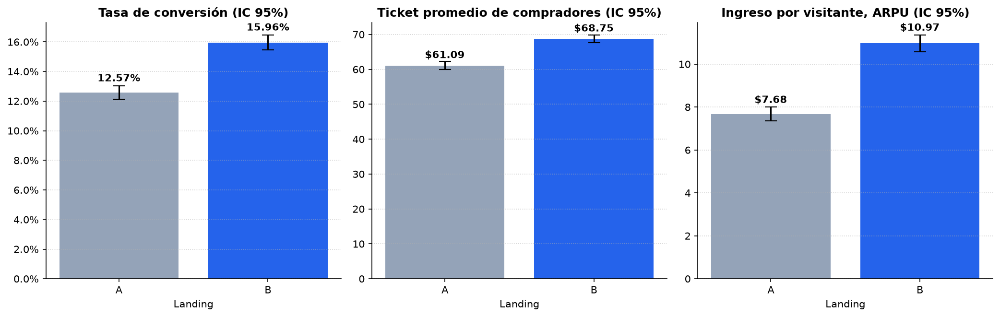
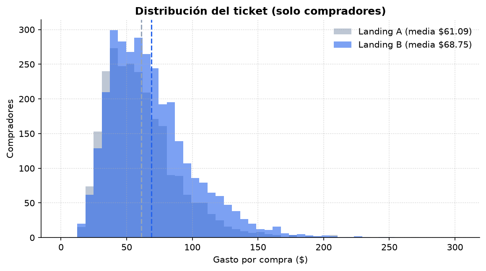
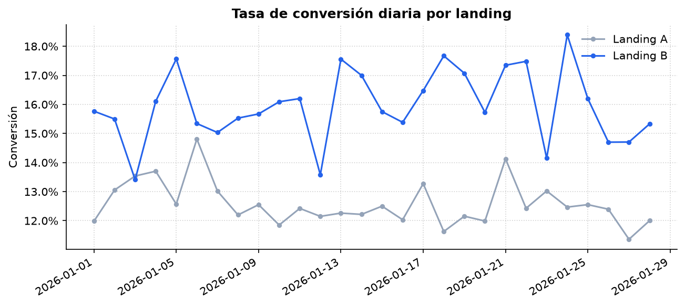
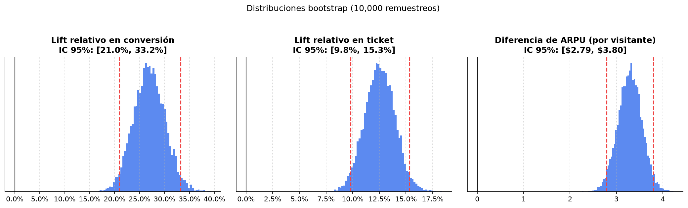
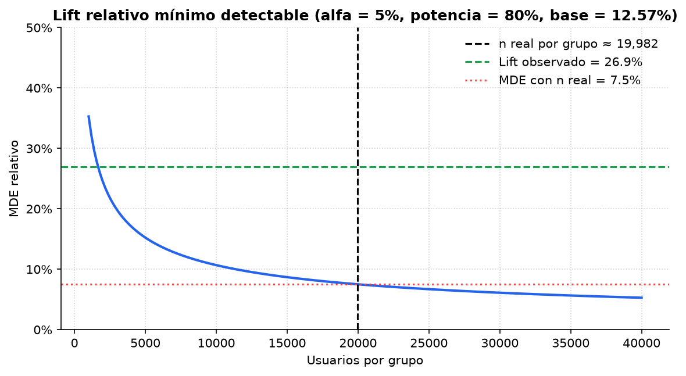
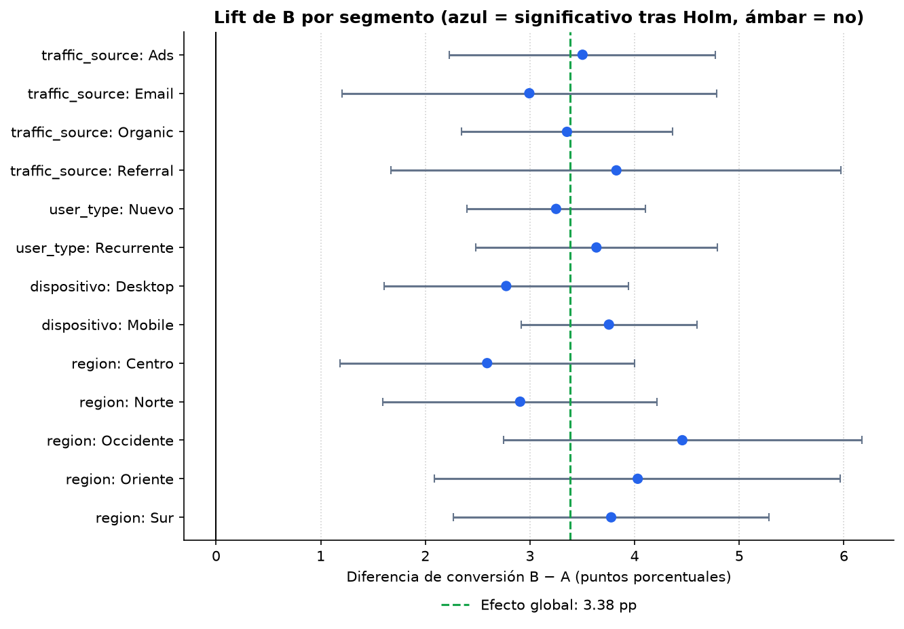
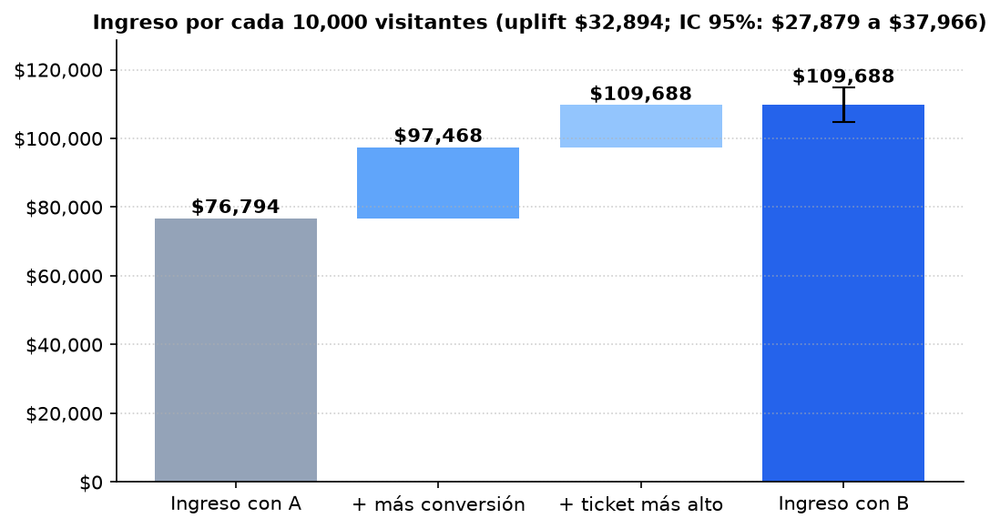

# Prueba A/B de landing pages: ¿conviene lanzar la versión B? · Landing page A/B test

**Proyecto de portafolio** de [Mario Zarza Zárraga](https://github.com/ZarzaZMario)

[Español](#español) · [English](#english)



---

## Español

Empezó como un proyecto del bootcamp de Data Analytics y lo amplié por mi cuenta con análisis de potencia, intervalos bootstrap, lift por segmento con corrección por comparaciones múltiples, controles de calidad del experimento (SRM) y una estimación del impacto en ingresos. El notebook está en español.

### Problema de negocio

Una empresa mostró dos versiones de su landing page (A = actual, B = nueva) a 40,000 usuarios durante 28 días. La pregunta: **¿B genera más compras y más ingreso que A, con evidencia suficiente para lanzarla al 100% del tráfico?**

### Datos

`data/landing_experiment.csv` (3.3 MB, 40,000 filas, una por usuario). Datos sintéticos con fines educativos.

| Columna | Descripción |
|---|---|
| `user_id` | Identificador único del usuario |
| `date` | Día de exposición (1 al 28 de enero de 2026) |
| `landing` | Versión mostrada: A o B |
| `region` | Norte, Centro, Sur, Occidente, Oriente |
| `dispositivo` | Mobile o Desktop |
| `traffic_source` | Organic, Ads, Email, Referral |
| `user_type` | Nuevo o Recurrente |
| `converted` | 1 si compró, 0 si no |
| `gasto` | Monto de la compra (0 si no compró). El dataset no especifica la moneda; se reporta como \$ |

### Métodos

1. **Controles de calidad:** nulos, duplicados, usuarios en ambas versiones, consistencia entre `converted` y `gasto`, **Sample Ratio Mismatch** (chi-cuadrada contra 50/50, total y por día) y balance de segmentos entre A y B.
2. **Conversión:** prueba z de dos proporciones, chi-cuadrada e IC de Wilson / Newcombe.
3. **Ticket promedio (solo compradores):** revisión de la distribución, **t de Welch**, Mann-Whitney como robustez y d de Cohen.
4. **ARPU (ingreso por visitante):** t de Welch e IC al 95%.
5. **Estabilidad diaria:** conversión por día y tendencia del lift (efecto novedad).
6. **Bootstrap** (10,000 remuestreos): IC del lift relativo en conversión y ticket, y de la diferencia de ARPU.
7. **Potencia:** efecto mínimo detectable (MDE), tamaño de muestra necesario para distintos lifts y potencia alcanzada.
8. **Segmentos:** lift de B en 13 segmentos con corrección de **Holm** y **Bonferroni**; revisión de **paradoja de Simpson** con Mantel-Haenszel y prueba de homogeneidad de Breslow-Day.
9. **Impacto de negocio:** ingreso adicional proyectado por cada 10,000 visitantes, con IC bootstrap y descomposición entre conversión y ticket.
10. **SQL:** consultas en DuckDB (`sql/`) que reproducen la conversión por variante y por segmento.

### Resultados clave

| Métrica | A | B | Diferencia B − A | IC 95% | Valor p |
|---|---:|---:|---:|---:|---:|
| Usuarios | 19,982 | 20,018 | SRM: p = 0.857 | — | — |
| Tasa de conversión | 12.57% | 15.96% | +3.38 pp (+26.9%) | +2.70 a +4.07 pp | 3.8 × 10⁻²² |
| Ticket promedio (compradores) | \$61.09 | \$68.75 | +\$7.66 (+12.5%) | \$6.08 a \$9.24 | 3.6 × 10⁻²¹ |
| ARPU (por visitante) | \$7.68 | \$10.97 | +\$3.29 (+42.8%) | \$2.79 a \$3.79 | 1.1 × 10⁻³⁷ |

- **Validez del experimento:** sin nulos ni duplicados, ningún usuario en ambas versiones, sin SRM (B recibió 50.05% del tráfico) y segmentos balanceados entre A y B.
- **Bootstrap:** lift en conversión +26.9% (IC +21.0% a +33.2%); lift en ticket +12.5% (IC +9.8% a +15.3%). En ninguno de los 10,000 remuestreos B quedó por debajo de A.
- **Potencia:** con ~20,000 usuarios por grupo y base de 12.57%, el MDE era de 0.94 pp (**7.5% relativo**) con 80% de potencia. El lift observado es más de tres veces ese valor (potencia ≈ 100%). Un lift de 5% habría requerido ~44,600 usuarios por grupo.
- **Segmentos:** B gana en los 13 segmentos y todos siguen siendo significativos tras Holm. No hay paradoja de Simpson (razón de momios cruda 1.320 vs. ajustada 1.320–1.321). El efecto podría ser mayor en Mobile (+3.75 pp) que en Desktop (+2.77 pp), pero no es concluyente tras corregir.
- **Estabilidad:** B convierte más que A en 27 de 28 días, sin tendencia significativa del lift (p = 0.137).
- **Impacto:** por cada 10,000 visitantes, B genera ~338 compras adicionales (IC 270 a 407) y **\$32,894 de ingreso adicional** (IC \$27,879 a \$37,966). Cerca del 63% viene de la mayor conversión y el 37% del ticket más alto.

### Gráficas

| | |
|---|---|
|  |  |
|  |  |
|  |  |

### Recomendación

**Lanzar la Landing B al 100% del tráfico.** Mejora conversión, ticket y ARPU, el efecto es consistente en todos los segmentos y en el tiempo, y el experimento tenía potencia de sobra. Siguientes pasos:

1. Mantener un grupo de control pequeño (por ejemplo, 5% con A) unas semanas después del lanzamiento para confirmar que el efecto se sostiene.
2. Probar en un experimento dedicado si B funciona aún mejor en Mobile, con el tamaño de muestra calculado de antemano.
3. Para tests futuros con efectos esperados de ~5%, planear ~45,000 usuarios por grupo.

### Limitaciones

- La ventana de 28 días no captura efectos de largo plazo, estacionalidad ni recompras.
- El ingreso es bruto: no hay datos de margen, devoluciones ni costo de implementación.
- El dataset no especifica la moneda.
- Canal y tipo de usuario no se asignaron al azar; las diferencias entre ellos son descriptivas. Solo A vs B es causal.
- Los datos parecen sintéticos (cero nulos, tráfico diario muy estable, lift de +27%, mayor de lo habitual en pruebas reales). Los métodos aplican igual, pero las magnitudes no son una referencia de la industria.

### Cómo ejecutar

```bash
python -m venv .venv && source .venv/bin/activate
pip install -r requirements.txt

# Notebook completo (desde la raíz del repo o desde notebook/)
jupyter nbconvert --to notebook --execute --inplace notebook/landing_ab_test_analysis.ipynb

# Consultas SQL con DuckDB
python sql/run_queries.py
```

El notebook se guarda con todas sus salidas, así que se puede leer en GitHub sin ejecutarlo. Las gráficas se regeneran en `images/`.

### Herramientas

Python · pandas · NumPy · SciPy · statsmodels · matplotlib · DuckDB (SQL) · Jupyter

---

## English

This started as a Data Analytics bootcamp project, and I extended it independently with power analysis, bootstrap confidence intervals, segment-level lift with multiple-comparison correction, experiment health checks (SRM) and a revenue impact estimate. The notebook is written in Spanish (my native language); the key results are summarized below.

### Business problem

A company showed two versions of its landing page (A = current, B = new) to 40,000 users over 28 days. The question: **does B drive more purchases and more revenue than A, with enough evidence to roll it out to 100% of traffic?**

### Dataset

`data/landing_experiment.csv` (3.3 MB, 40,000 rows, one per user). Synthetic data for educational purposes. Columns: user ID, exposure date (Jan 1–28, 2026), landing version (A/B), region, device, traffic source, user type (new/returning), `converted` (0/1) and `gasto` (purchase amount, 0 if no purchase; the currency is not specified, so amounts are shown as \$).

### Methods

1. **Data and experiment checks:** nulls, duplicates, users exposed to both versions, consistency between `converted` and spend, **Sample Ratio Mismatch** (chi-square vs. 50/50, overall and per day) and segment balance between A and B.
2. **Conversion:** two-proportion z-test, chi-square, Wilson / Newcombe CIs.
3. **Average order value (buyers only):** distribution check, **Welch's t-test**, Mann-Whitney as a robustness check, Cohen's d.
4. **ARPU (revenue per visitor):** Welch's t-test and 95% CI.
5. **Daily stability:** daily conversion and lift trend (novelty effect).
6. **Bootstrap** (10,000 resamples): CIs for relative lift in conversion and order value, and for the ARPU difference.
7. **Power analysis:** minimum detectable effect (MDE), required sample size for several lifts, achieved power.
8. **Segments:** B's lift in 13 segments with **Holm** and **Bonferroni** correction; **Simpson's paradox** check with Mantel-Haenszel and the Breslow-Day homogeneity test.
9. **Business impact:** projected extra revenue per 10,000 visitors with a bootstrap CI, split into conversion and order-value effects.
10. **SQL:** DuckDB queries (`sql/`) reproducing conversion by variant and by segment.

### Key results

| Metric | A | B | Difference B − A | 95% CI | p-value |
|---|---:|---:|---:|---:|---:|
| Users | 19,982 | 20,018 | SRM: p = 0.857 | — | — |
| Conversion rate | 12.57% | 15.96% | +3.38 pp (+26.9%) | +2.70 to +4.07 pp | 3.8 × 10⁻²² |
| Average order value (buyers) | \$61.09 | \$68.75 | +\$7.66 (+12.5%) | \$6.08 to \$9.24 | 3.6 × 10⁻²¹ |
| ARPU (per visitor) | \$7.68 | \$10.97 | +\$3.29 (+42.8%) | \$2.79 to \$3.79 | 1.1 × 10⁻³⁷ |

- **Valid experiment:** no nulls or duplicates, no user in both versions, no SRM (B got 50.05% of traffic) and balanced segments.
- **Bootstrap:** conversion lift +26.9% (CI +21.0% to +33.2%); order-value lift +12.5% (CI +9.8% to +15.3%). B was never below A in 10,000 resamples.
- **Power:** with ~20,000 users per group and a 12.57% baseline, the MDE was 0.94 pp (**7.5% relative**) at 80% power. The observed lift is more than three times that (power ≈ 100%). A 5% lift would have needed ~44,600 users per group.
- **Segments:** B wins in all 13 segments, all still significant after Holm. No Simpson's paradox (crude odds ratio 1.320 vs. adjusted 1.320–1.321). The effect may be larger on mobile (+3.75 pp) than desktop (+2.77 pp), but this is not conclusive after correction.
- **Stability:** B converts better than A on 27 of 28 days, with no significant trend in the lift (p = 0.137).
- **Impact:** per 10,000 visitors, B adds ~338 purchases (CI 270 to 407) and **\$32,894 in revenue** (CI \$27,879 to \$37,966). About 63% comes from higher conversion and 37% from higher order value.

### Recommendation

**Roll out Landing B to 100% of traffic.** It improves conversion, order value and ARPU, the effect is consistent across segments and over time, and the test was well powered. Next steps: keep a small holdout (e.g. 5% on A) for a few weeks after launch, test whether B works even better on mobile in a dedicated experiment, and plan ~45,000 users per group for future tests expecting ~5% lifts.

### Limitations

28-day window (no long-term or repeat-purchase effects); gross revenue only (no margin, returns or implementation cost); currency not specified; traffic source and user type were not randomized, so differences between them are descriptive; the data looks synthetic, so the magnitudes should not be read as industry benchmarks.

### How to run

```bash
python -m venv .venv && source .venv/bin/activate
pip install -r requirements.txt
jupyter nbconvert --to notebook --execute --inplace notebook/landing_ab_test_analysis.ipynb
python sql/run_queries.py
```

### Tools

Python · pandas · NumPy · SciPy · statsmodels · matplotlib · DuckDB (SQL) · Jupyter

---

## Estructura · Repository structure

```text
landing-ab-test-analysis/
├── README.md
├── LICENSE
├── requirements.txt
├── .gitignore
├── data/landing_experiment.csv              # 40,000 usuarios / users (3.3 MB)
├── notebook/landing_ab_test_analysis.ipynb  # análisis completo con salidas / full analysis with outputs (ES)
├── sql/
│   ├── conversion_queries.sql               # consultas DuckDB / DuckDB queries
│   └── run_queries.py
└── images/                                  # gráficas exportadas / exported charts
```

## Autor · Author

**Mario Zarza Zárraga**
[LinkedIn](https://www.linkedin.com/in/mario-zarza-z%C3%A1rraga-26777729) · [GitHub](https://github.com/ZarzaZMario) · Otros proyectos / Other projects: [Give Me Some Credit](https://github.com/ZarzaZMario/give-me-some-credit-risk-analysis) · [n8n USD/MXN monitor](https://github.com/ZarzaZMario/n8n-usd-mxn-monitor)
